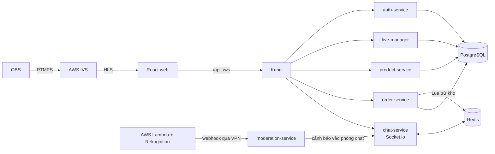

# realtime-live-commerce-flashsale-microservices

> Ứng dụng livestream bán hàng kiểu TikTok Shop: người bán phát live qua OBS → AWS IVS, người xem chat realtime và săn flash sale, kho được trừ nguyên tử bằng Redis Lua nên **không bán vượt**. Ảnh live được kiểm duyệt bằng AI (Rekognition).

Hạ tầng và triển khai (GitOps): [live-commerce-hybrid-k8s-gitops-observability-dr](https://github.com/clgp-aint-cool/live-commerce-hybrid-k8s-gitops-observability-dr)


## Kiến trúc ứng dụng



| Service | Cổng | Vai trò |
|---|---|---|
| auth-service | 3006 | Đăng ký, đăng nhập người mua, JWT |
| live-manager | 3005 | Người bán, kênh IVS, stream key, phiên live, ghim sản phẩm |
| product-service | 3002 | Danh mục sản phẩm |
| order-service | 3003 | Đặt hàng: Redis Lua trừ kho theo phiên, lưu PostgreSQL |
| chat-service | 3001 | Chat realtime, Socket.io + Redis adapter |
| moderation-service | 3004 | Nhận webhook kiểm duyệt từ AWS, báo vào chat |
| web | 80 | React + Vite: xem live, đơn hàng, trang người bán, admin |

Stack: NestJS 11 + TypeScript (Node 22), React + Vite, PostgreSQL, Redis, Kong.

## Chạy cục bộ

```bash
cp .env.example .env
make up          # docker compose: toàn bộ app + Kong, mở http://localhost:8000
make test        # e2e: 88 kiểm tra
make loadtest    # k6: 5.000 request, tồn kho 100 => đúng 100 đơn
```

Dev một service: `make infra` (chỉ PostgreSQL + Redis) rồi `npm run dev` trong thư mục service. Chi tiết: [docs/local-testing.md](docs/local-testing.md).

## CI/CD

PR chạy `ci.yml`. Merge vào `main` thì `build-and-deploy.yml` build image, đẩy lên Harbor và cập nhật tag dev trong repo infra; ArgoCD tự đồng bộ. Xem [docs/ci-cd-flow.md](docs/ci-cd-flow.md).

Tài liệu khác: [live-manager](docs/live-manager.md) (OBS, IVS, IAM) · [live-sessions](docs/live-sessions.md) · [conventions](docs/conventions.md)
